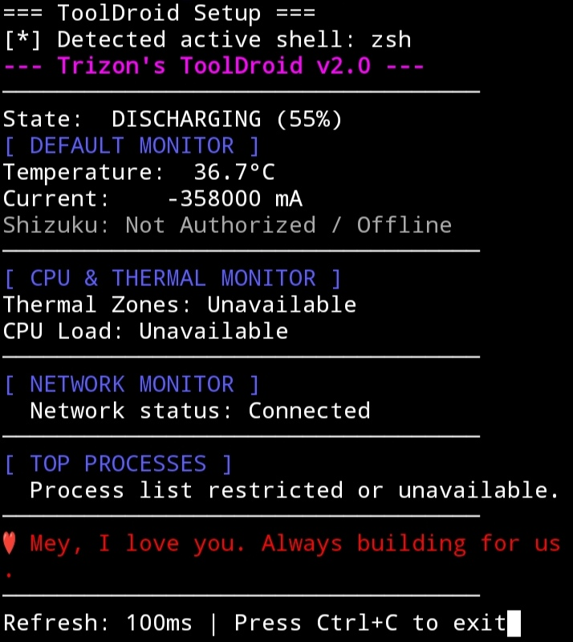

# ToolDroid
[](https://github.com/ActuallyTrizon/ToolDroid/releases/latest)

**ToolDroid** is a modular, extensible Android Terminal User Interface (TUI) utility suite built for **Termux**. It bridges **Termux-API** and **Shizuku (`rish`)** to provide deep hardware insights, thermal monitoring, process analysis, and network diagnostics that standard apps cannot reach.

---

## Gallery
<p align="center">
  
</p>

---

## Modular Structure
ToolDroid features a dynamic **Cog plugin system**. Adding new monitors is as simple as dropping a script into the `cogs/` directory:
* **Battery Cog (`battery.py`)**: Real time percentage, current flow rate, temperature and Shizuku powered battery health tracking.
* **CPU & Thermal Cog (`cpu.py`)**: Real-time thermal zone temperatures and active CPU cluster load states.
* **Process Cog (`processes.py`)**: Lists top resource-heavy background processes via Shizuku permissions.
* **Network Cog (`network.py`)**: Monitors active network routing and connection states.

---

## Installation & Setup

Clone the repository and run the setup installer:

```bash
git clone [https://github.com/ActuallyTrizon/ToolDroid.git](https://github.com/ActuallyTrizon/ToolDroid.git)
cd ToolDroid
bash setup.sh
```
